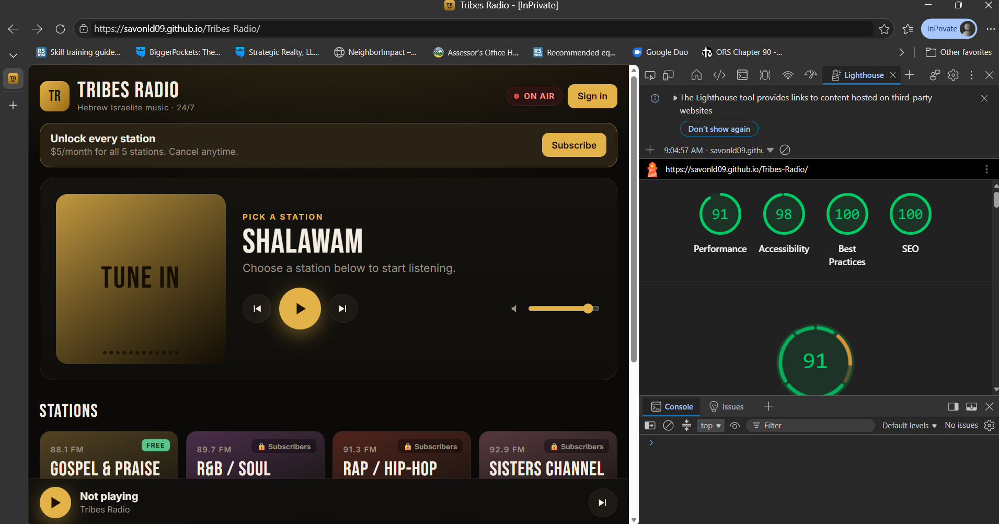
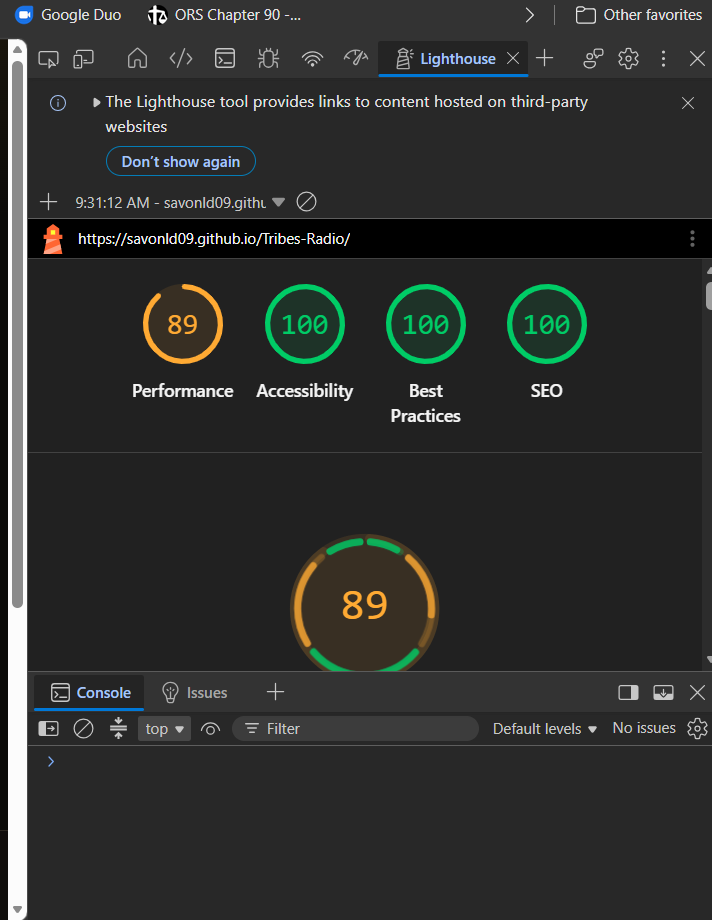

# Tribes Radio

**24/7 internet radio for Hebrew Israelite music, with five genre stations and a $5/month subscription.**

🔗 **Live app:** [savonld09.github.io/Tribes-Radio](https://savonld09.github.io/Tribes-Radio)
Status: pre-launch, running in Stripe test mode with test tracks.

<p>
  
  
  
  
</p>

## What it does

- **Five live stations:** Gospel & Praise (free), plus R&B / Soul, Rap / Hip-Hop, Sisters Channel and Feast Days for subscribers
- **Subscriptions:** $5/month through Stripe, with a customer portal to manage or cancel
- **Passwordless sign-in:** listeners get a magic link by email
- **Protected streams:** paid stations only play for active subscribers, and the real stream addresses stay hidden
- **Now playing, up next and recently played:** song info updates live from the streaming server
- **Installable app:** add it to a phone's home screen, with lock-screen play/pause controls and offline caching of the app shell
- **Off-air detection:** if a station's AutoDJ stops, the app shows "Off air" instead of playing the server's fallback static
- **In-app feedback:** listeners can report bugs or send ideas, saved to Supabase (insert-only, row-level security)

## How it works

```
Listener's phone or browser (PWA on GitHub Pages)
   │
   ├── Sign in / subscription status ──► Supabase (Postgres + Auth)
   │                                         ▲
   │                                         │ webhook keeps status in sync
   │                                     Stripe (subscriptions)
   │
   └── Play a station ──► Cloudflare Worker (stream gate)
                              │  checks the listener's subscription
                              ▼
                          AzuraCast streaming server
                          (Icecast + Liquidsoap in Docker on a DigitalOcean Ubuntu server)
```

## Tech stack

| Area | Tools |
| --- | --- |
| Front end | HTML, CSS, vanilla JavaScript; Progressive Web App (manifest, service worker, Media Session API) |
| Hosting | GitHub Pages; custom domain and DNS on Cloudflare; HTTPS via Let's Encrypt |
| Streaming | AzuraCast (Icecast + Liquidsoap) in Docker on a DigitalOcean Ubuntu server |
| Back end | Supabase: Postgres with row-level security, email magic-link auth, Edge Function for the Stripe webhook |
| Payments | Stripe subscriptions, Payment Link, webhooks, customer portal |
| Access control | Cloudflare Worker that verifies subscriptions before serving paid streams |

## Project structure

```
index.html              App layout
app.js                  Player, stations, sign-in and subscription logic
app.css                 Styles
config.js               Supabase, Stripe and stream settings
sw.js                   Service worker (offline caching)
manifest.webmanifest    Install settings for the PWA
icon-*.png              App icons
```

The Supabase database schema, the Stripe webhook Edge Function and the Cloudflare Worker that gates streams are deployed directly to those services and aren't in this repo yet.

## Running it yourself

1. Create a Supabase project with a subscriptions table and email magic-link sign-in.
2. Deploy a Supabase Edge Function that receives Stripe webhooks and updates subscription status.
3. Set up AzuraCast with Docker on a Linux server and create the stations.
4. Deploy a Cloudflare Worker that checks a listener's subscription before passing through a paid stream.
5. Fill in `config.js` with your own settings and publish the files to GitHub Pages or any static host.

## Challenges I solved

- **Server overload:** I diagnosed CPU and memory overload on the streaming server and scaled it up.
- **Webhook and API failures:** I used the Supabase and Cloudflare logs to track down 404 and 500 errors and get the Stripe webhook syncing subscriptions correctly.
- **Keeping paid streams private:** I moved stream access behind a Cloudflare Worker, so the app never exposes the real stream addresses and non-subscribers can't play locked stations.
- **Static instead of "offline":** when a station's AutoDJ stopped, AzuraCast kept serving a fallback mount, so the stream looked healthy (HTTP 200). I found that AzuraCast's public now-playing API hides private stations (404), switched the Worker to the authenticated station status endpoint, and now block playback when AutoDJ or Icecast is down.
- **CORS for local testing:** the Worker only allowed the live site, so localhost tests failed silently. I changed it to accept a list of allowed origins.
- **Email rate limits:** Supabase's built-in email only sends a few sign-in links per hour. I connected custom SMTP through Brevo on my own domain.

## Definition of Done

A change counts as done when:

- It works on phone and desktop
- There are no red errors in the browser Console
- It has a test case, and the test passes
- Any bug was logged in Jira before it was fixed
- The work was done on a Git branch, then merged
- The live site was checked after pushing

## How I built it

I designed Tribes Radio and built it with AI-assisted development (Claude). I set up and configured every service myself (Supabase, Stripe, Cloudflare, DigitalOcean and AzuraCast), tested each part, and debugged problems from logs. As I work through the Meta Front-End Developer certificate, I plan to rewrite parts of the front end by hand.

## Lighthouse audit (mobile)

| Date | Performance | Accessibility | Best Practices | SEO |
|---|---|---|---|---|
| Nov 18, 2026 | 89 | 100 | 100 | 100 |
| Nov 26, 2026 | **100** | 100 | 100 | 100 |

- Added a `<main>` landmark (Accessibility 98 → 100).
- Loaded Google Fonts asynchronously, so they no longer block the first paint (about 780 ms saved).
- Cut layout shift (CLS) below 0.1: size-matched fallback font for Inter, `display=optional` for the Bebas Neue headings, and the subscribe banner shown from the first paint instead of popping in.

| Before | After |
|---|---|
|  |  |

## What's next

- Launch with real artists' music once license agreements are reviewed
- Automated tests and a QA test plan
- Native app store versions

---

Built by Savon Davis (Chaama), founder of Israelite Experiences · [GitHub](https://github.com/savonld09)
